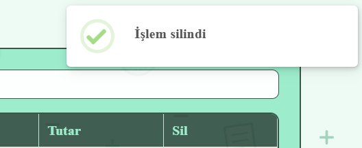

# Özellikler ve Metotlar

Uygulamanın tüm mantığı `src/app/app.ts` dosyasındaki `App` component'indedir.

<table data-search="false"><thead><tr><th width="220.79998779296875">Metot</th><th>Görevi</th></tr></thead><tbody><tr><td><code>add()</code></td><td>Formu doğrular, işlemi ekler, formu temizler ve yeni satırı vurgular</td></tr><tr><td><code>today()</code></td><td>Bugünün tarihini <code>yyyy-aa-gg</code> biçiminde döndürür</td></tr><tr><td><code>capitalize(text)</code></td><td>Açıklamanın ilk harfini büyütür</td></tr><tr><td><code>filterTransaction()</code></td><td>Arama metnine uyan işlemleri döndürür</td></tr><tr><td><code>delete(transaction)</code></td><td>Onay aldıktan sonra işlemi siler</td></tr><tr><td><code>totalIncome()</code></td><td>Gelirlerin toplamını döndürür</td></tr><tr><td><code>totalExpense()</code></td><td>Giderlerin toplamını döndürür</td></tr><tr><td><code>balance()</code></td><td>Gelir ile gider arasındaki farkı döndürür</td></tr><tr><td><code>transactionNum()</code></td><td>İşlem sayısını döndürür</td></tr><tr><td><code>save()</code></td><td>Listeyi <code>localStorage</code>'a yazar</td></tr><tr><td><code>load()</code></td><td>Kayıtlı listeyi okur; constructor'da çağrılır</td></tr><tr><td><code>showError(message)</code></td><td>Uyarı penceresi gösterir</td></tr><tr><td><code>showSuccess(message)</code></td><td>Sağ üstte kısa süreli bildirim gösterir</td></tr></tbody></table>

<figure><figcaption></figcaption></figure>

### İşlem ekleme

İşlemler sol paneldeki form ile eklenir. Form `(ngSubmit)="add()"` ile bağlıdır.

<table><thead><tr><th width="142.80001831054688">Alan</th><th>Zorunluluğu var mı?</th><th>Özellik</th></tr></thead><tbody><tr><td>Tarih</td><td>Evet</td><td>Takvimde bugünden sonraki günler seçilemez</td></tr><tr><td>İşlem türü</td><td>Evet</td><td>Gelir veya gider</td></tr><tr><td>Açıklama</td><td>Giderde evet, gelirde hayır</td><td>Yıldız ve placeholder seçilen türe göre değişir</td></tr><tr><td>Tutar</td><td>Evet</td><td>0'dan büyük olmalı, ondalık kabul edilir</td></tr></tbody></table>

Kontroller `add()` içinde sırayla yapılır. İlk başarısız kuralda `showError()` ile uyarı gösterilir ve ekleme durdurulur.


HTML'deki `min` ve `[max]` özellikleri yalnızca kullanıcıya yardımcı olur. Angular formları tarayıcı doğrulamasını kapattığı için asıl kontrol `add()` metodundadır.


#### İleri tarihi engelleme

`today()` bugünün tarihini yerel saate göre üretir ve tarih alanının üst sınırı olarak kullanılır.

```typescript
today(): string {
  const now = new Date();
  const year = now.getFullYear();
  const month = String(now.getMonth() + 1).padStart(2, '0');
  const day = String(now.getDate()).padStart(2, '0');
  return `${year}-${month}-${day}`;
}
```

```html
<input type="date" id="date" [(ngModel)]="date" name="date" [max]="today()" />
```

Tarihler `yyyy-aa-gg` biçiminde olduğu için `add()` içindeki `this.date > this.today()` karşılaştırması da doğru çalışır ve elle yazılan ileri tarihleri yakalar.

<div align="center"><figure><figcaption><p>Eksik bilgi bildirimi</p></figcaption></figure></div>

#### Açıklamanın yazımı

Açıklama kaydedilmeden önce boşluklardan arındırılır ve ilk harfi Türkçe kurallarına göre büyütülür; "ilaç", "İlaç" olarak kaydedilir.

```typescript
capitalize(text: string): string {
  if (!text) return text;
  return text.charAt(0).toLocaleUpperCase('tr') + text.slice(1);
}
```

#### Ekleme ve vurgulama

Doğrulamadan geçen işlem diziye eklenir, form temizlenir ve liste kaydedilir. Yeni satır 2 saniye vurgulanır ve tabloda görünür alana kaydırılır.

```typescript
...
this.cdr.detectChanges();
document.getElementById('row-' + newTransaction.id)
  ?.scrollIntoView({ behavior: 'smooth' });
clearTimeout(this.highlightTimer);
this.highlightTimer = setTimeout(() => {
  this.highlightedId = null;
  this.cdr.markForCheck();
}, 2000);
```

* `detectChanges()` yeni satırı hemen çizer; satır ekranda olmadan `scrollIntoView` çalışmaz.
* `clearTimeout`, art arda eklemelerde önceki zamanlayıcının yeni vurguyu erken kapatmasını önler.

### Listeleme ve arama

Tablo her zaman `filterTransaction()` sonucunu gösterir. Satırlar `@for` ile üretilir; `track transaction.id` ile silinen işlemde yalnızca o satır kaldırılır. Sıra sütunu `$index + 1` olduğu için silme sonrasında numaralar atlamaz.

Gelir satırları `income-row`, gider satırları `expense-row` sınıfıyla renklendirilir. Tutar gelirde `+`, giderde `-` işaretiyle gösterilir.

```typescript
filterTransaction(): Transaction[] {
  const searchText = this.searchTransaction.trim().toLocaleLowerCase('tr');
  return this.transactions.filter((t) =>
    t.explanation.toLocaleLowerCase('tr').includes(searchText),
  );
}
```

`toLocaleLowerCase('tr')` sayesinde "İLAÇ" araması "İlaç" kaydını bulur. Kutu doluyken görünen x butonu aramayı temizler.

### İşlem silme

Silme butonu önce onay sorar; işlem yalnızca "Sil" seçilirse kaldırılır.

```typescript
delete(transaction: Transaction) {
  Swal.fire({
    ...
  }).then(result => {
    if (result.isConfirmed) {
      this.transactions = this.transactions.filter(t => t.id !== transaction.id);
      ...
    }
  });
}
```

Karşılaştırma obje yerine `id` ile yapılır, böylece `localStorage`'dan yüklenen kayıtlarda da doğru çalışır.

Silme kodu onay penceresi kapandıktan sonra `.then()` içinde, vurgu kaldırma kodu ise `setTimeout` içinde çalışır. Bu yüzden ikisinde de ekranın yenilenmesi `private cdr = inject(ChangeDetectorRef)` ile alınan `markForCheck()` ile Angular uyarılarak sağlanır.

### Hesaplamalar

Sağ panelin altındaki;

* toplam gelir totalIncome() ile
* toplam gider totalExpense() ile
* bakiye balance() ile
* işlem sayısı transactionNum() ile

ekran her güncellendiğinde yeniden hesaplanır.

### Veri saklama

İşlemler `localStorage`'da `transactions` anahtarı altında JSON olarak saklanır ve tarayıcı kapatılınca silinmez. `save()` her ekleme ve silmeden sonra, `load()` component oluşturulurken çağrılır.

```typescript
save() {
  localStorage.setItem('transactions', JSON.stringify(this.transactions));
}

load() {
  const data = localStorage.getItem('transactions');
  if (!data) {
    return;
  }

  try {
    this.transactions = JSON.parse(data);
  } catch {
    this.transactions = [];
  }

  if (this.transactions.length > 0) {
    const maxId = Math.max(...this.transactions.map((t) => t.id));
    this.nextId = maxId + 1;
  }
}
```

* Depodaki veri bozuksa `try/catch` sayesinde uygulama boş listeyle açılır.
* `nextId` en büyük id'nin bir fazlasından devam eder; yenilemeden sonra id çakışması olmaz.


`localStorage` yalnızca o tarayıcıya ve o bilgisayara özeldir.


### Bildirimler

Tarayıcının `alert()` kutusu stillendirilemediği için SweetAlert2 kullanılır (`npm install sweetalert2`).

Uygulamada üç tür pencere kullanılır. Doğrulama başarısız olduğunda showError() ile bir uyarı penceresi açılır. Bir işlem silinmeden önce onay penceresi gösterilir. Silme tamamlandığında ise showSuccess() ile sağ üstte kısa süreli bir bildirim çıkar.

<div align="left"><figure><figcaption><p>İşlem silme onay bildirimi</p></figcaption></figure> <figure><figcaption><p>"İşlem Silindi" bildirimi</p></figcaption></figure></div>
