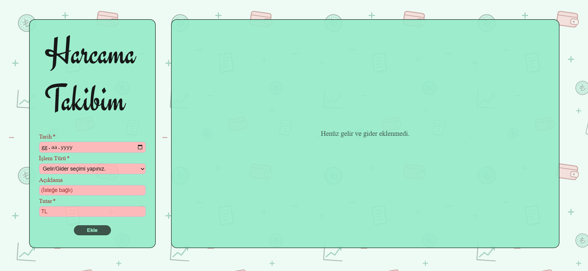

# Veri Modeli ve Interface(Arayüz)

## Veri modeli

Her gelir veya gider tek bir `Transaction` objesidir. Tüm işlemler component içindeki `transactions` dizisinde tutulur; gelir ve gider ayrımı `type` alanıyla yapılır.

```typescript
export type TransactionType = 'income' | 'expense';

export interface Transaction {
  id: number;
  date: string;
  explanation: string;
  amount: number;
  type: TransactionType;
}
```

<table><thead><tr><th width="148">Alan</th><th>Açıklama</th></tr></thead><tbody><tr><td><code>id</code></td><td>Benzersiz kimlik. <code>nextId</code> sayacından üretilir</td></tr><tr><td><code>date</code></td><td><code>yyyy-aa-gg</code> biçiminde tarih</td></tr><tr><td><code>explanation</code></td><td>Açıklama. Gelirde boş olabilir</td></tr><tr><td><code>amount</code></td><td>0'dan büyük tutar</td></tr><tr><td><code>type</code></td><td>Yalnızca <code>'income'</code> veya <code>'expense'</code></td></tr></tbody></table>

* Tüm işlemler tek dizide tutulur; tablo eklenme sırasını korur, toplamlar `filter` ile türe göre ayrılır.
* `TransactionType` bir union type olduğu için hatalı bir değer derleme sırasında yakalanır.
* `date` alanı string'dir, çünkü `<input type="date">` metin döndürür ve metin `localStorage`'a doğrudan kaydedilebilir.
* `id`, `transactions.length + 1` yerine ayrı bir sayaçla üretilir; böylece silme sonrasında aynı id iki işleme verilmez.

## Arayüz

### Düzen

Sayfa iki panelden oluşur. Geniş ekranda yan yana, 720 px'ten dar ekranlarda alt alta dizilir.

<table><thead><tr><th width="263.20001220703125">Panel</th><th>İçerik</th></tr></thead><tbody><tr><td>Sol panel (<code>aside.sidebar</code>)</td><td>Başlık, form alanları ve panelin en altındaki Ekle butonu</td></tr><tr><td>Sağ panel (<code>section.content</code>)</td><td>Arama kutusu, kendi içinde kayan tablo ve dört özet kutusu</td></tr></tbody></table>

Hiç işlem yokken sağ panelde yalnızca "Henüz gelir ve gider eklenmedi." mesajı görünür.

<figure><figcaption></figcaption></figure>

### Tarayıcı ayrıntıları

* Tutar alanındaki artırma/azaltma okları Chrome, Edge ve Safari'de gizlenmiştir.
* Açıklama alanında `autocomplete="off"` kullanılır; aksi halde tarayıcının öneri listesi alanın arka planını beyaza çevirir.
